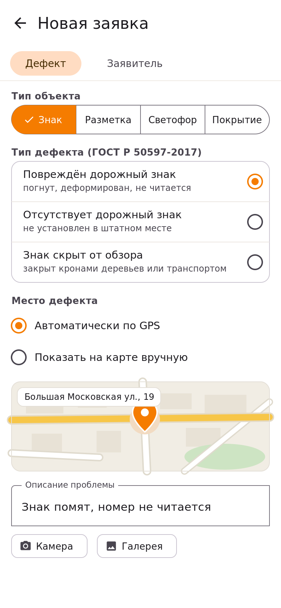

# Справка приложения «Мониторинг дорожной инфраструктуры»

Это встроенная справка приложения, которое помогает жителям сообщать о дефектах дорожной инфраструктуры — повреждённых знаках, стёртой разметке, неработающих светофорах и выбоинах, — а администрации вовремя организовывать их устранение.

## Что вы найдёте в справке

- [Начало работы](/start/) — установка приложения и первые шаги;
- [Подача заявки о дефекте](/start/podacha-zayavki/) — пошаговая инструкция: от фото до кнопки «Подать заявку»;
- [Вход и аккаунт](/start/vhod-i-akkount/) — как войти, если вы уже подавали заявки;
- [Работа с заявками](/zayavki/) — что происходит с заявкой после отправки;
- [Статусы заявки](/zayavki/statusy/) — таблица всех статусов и их значения;
- [Частые вопросы](/faq/) — быстрые ответы на типовые вопросы.

## Как устроена подача заявки

Нажмите на картинку, чтобы перейти к пошаговой инструкции:

> *Совет:* заявку можно подать за минуту — место дефекта приложение определит само, а аккаунт создастся автоматически при отправке первой заявки.
