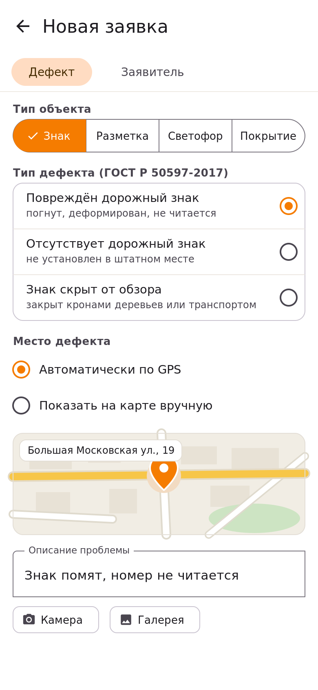
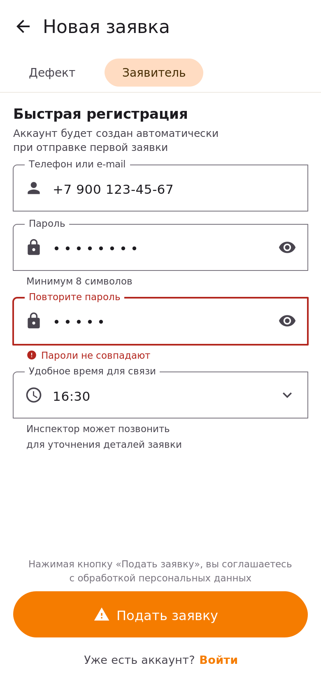
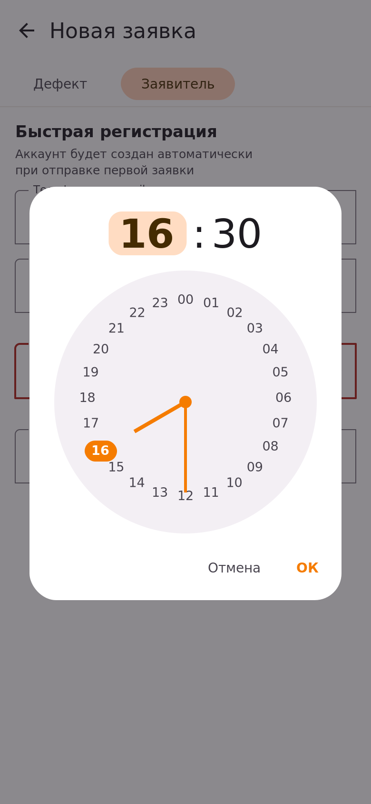

# Как подать заявку о дефекте

Это главный сценарий приложения: вы сообщаете о проблеме на дороге, а администрация организует её устранение. Вся подача занимает около минуты.

## Шаги

1. На главном экране нажмите кнопку **Сообщить о дефекте**.
2. На вкладке **«Дефект»** выберите тип объекта — сегментированная кнопка вверху: *Знак*, *Разметка*, *Светофор* или *Покрытие*.
3. В списке выберите тип дефекта. Список показывает **только те дефекты, которые относятся к выбранному объекту**.
4. Проверьте место дефекта. Приложение определит его автоматически; если место определилось неточно, выберите вариант *Показать на карте вручную* и укажите точку на карте.
5. Опишите проблему своими словами — так исполнителю будет проще сориентироваться.
6. По желанию добавьте фото кнопками **«Камера»** или **«Галерея»**.

7. Перейдите на вкладку **«Заявитель»** и укажите телефон — по нему можно уточнить детали заявки. При желании выберите *удобное время для связи*.
8. Придумайте пароль — он понадобится для входа с другого устройства. Нажмите **Подать заявку**.

> *Примечание:* пароль должен содержать не менее 8 символов. Если пароли в двух полях не совпадут, приложение покажет подсказку и не даст отправить форму — введённые данные при этом не сбросятся.

## Как выглядит форма

Вкладка «Заявитель» — контакты, пароль и удобное время для связи:

Время удобно выбрать в календарном диалоге — нажмите на поле «Удобное время для связи»:

## Что заполнять обязательно

Обязательных полей всего три: тип объекта, тип дефекта и место. Фото добавлять не обязательно, но заявки с фотографией проверяются быстрее.

## Чек-лист перед отправкой

- [ ] Тип объекта и тип дефекта выбраны
- [ ] Место на карте совпадает с реальным
- [ ] Описание понятно человеку, который не видел проблему
- [ ] Телефон указан верно
- [ ] Фото прикреплено (если качество дефекта не видно со слов)

## После отправки

Заявка попадает на проверку к модератору, а вы начнёте получать уведомления об изменении её статуса. Подробности — в разделе [«Что происходит с заявкой»](/zayavki/).
