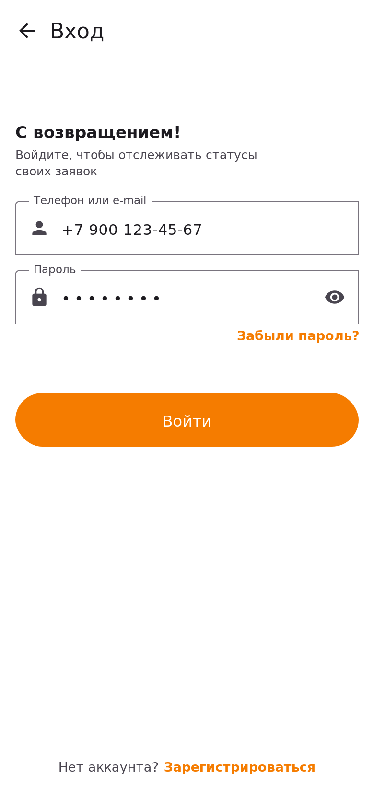

# Вход и аккаунт

## Когда нужен вход

Аккаунт создаётся автоматически при отправке первой заявки, поэтому специально регистрироваться не нужно. Экран входа понадобится в двух случаях:

- вы подали заявку, а теперь хотите **посмотреть её статус с другого устройства**;
- вы переустановили приложение и хотите вернуться к своим заявкам.

## Как войти

1. На вкладке «Заявитель» нажмите ссылку **«Уже есть аккаунт? Войти»** — откроется экран входа.
2. Введите телефон или e-mail, указанные при подаче заявки.
3. Введите пароль и нажмите **«Войти»**.

> **Черновик не потеряется:** если вы перешли на экран входа прямо из формы заявки, после входа форма откроется заполненной — описывать дефект заново не придётся.

## Если не входит

- Проверьте раскладку клавиатуры и не допускаете ли лишних пробелов в номере телефона.
- Пароль скрыт точками — нажмите на **значок глаза** в поле, чтобы увидеть введённые символы.
- Восстановите пароль по ссылке **«Забыли пароль?»** на экране входа: код подтверждения придёт в SMS на номер, указанный при подаче заявки.

## Как выйти из аккаунта

Откройте раздел профиля и нажмите **«Выйти»**. Поданные заявки останутся в системе и продолжат обрабатываться в обычном порядке.
